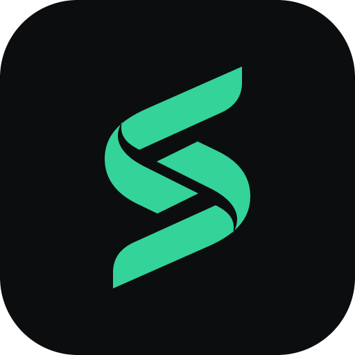

<!-- markdownlint-disable MD033 MD041 -->
<div align="center">



# Sweep

**Get your disk back from build caches.**

A free, open-source disk cleaner for developers on macOS. Sweep finds the gigabytes development leaves behind, tells you how safe each one is to remove, and removes only what you confirm.

[](https://github.com/abdulrasol/sweep/releases/latest)


[](LICENSE)
[](https://github.com/abdulrasol/sweep/releases)


### [⬇️ Download for macOS](https://github.com/abdulrasol/sweep/releases/latest) · [🌐 Website](https://sweep.subultech.top) · [🐞 Report an issue](https://github.com/abdulrasol/sweep/issues)

</div>

---

> [!NOTE]
> **Sweep is in beta.** It is used daily on macOS, and every cleanup rule is covered by tests, but rules are still being added and tuned. Items go to the Trash by default, so you can undo. Please [open an issue](https://github.com/abdulrasol/sweep/issues) if Sweep shows something it shouldn’t, or misses a cache it should find.

## Why Sweep

A `flutter run` failed with “not enough space”. The iPhone had plenty. The Mac had **1 GB** left, buried under years of Xcode DerivedData, `node_modules`, Gradle caches and old simulators nobody remembered making.

Sweep finds those leftovers in one scan and cleans them without ever risking your source code.

## How it works

1. **Scan.** Pick your projects folder. Sweep recognises each project by its files (`package.json`, `Cargo.toml`, `pubspec.yaml`, `build.gradle`…) and also checks the global caches in your home folder. Sizes count only the space you would really get back.
2. **Review.** Results are grouped by tool and labelled **Safe**, **Review** or **Danger**, with a note on what happens if you remove each one. Pick exactly what you want.
3. **Clean.** Items go to the Trash, or are deleted permanently if you prefer. Where a tool has its own cleanup command (`xcrun simctl`, `brew cleanup`, `docker prune`, `go clean`, `pnpm store prune`…), Sweep runs that instead.

## Safety levels

| Level | Meaning | Examples |
|---|---|---|
| 🟢 **Safe** | Comes back on its own the next time you build or run. | Build output, DerivedData, compiler caches, logs |
| 🟡 **Review** | Comes back, but costs a download or a long rebuild, or may hold something you care about. | Gradle caches, simulator runtimes, virtual environments, model caches |
| 🔴 **Danger** | Hard or impossible to get back. Needs a typed confirmation. | Unity and Unreal project data, device backups, local AI chat history |

## Built not to delete the wrong thing

These rules live in the Rust engine, not just in the interface:

- 🔒 **Your code is off limits.** Any folder inside a project that contains files tracked by git is skipped, whatever its name.
- 🚫 **Fixed blocklist.** `/`, your home folder, Documents, Desktop, Downloads, `/System`, `/Applications`, `/Library`, `/usr`, `/bin`, the Homebrew root and `~/Library` itself can never be removed.
- 🆔 **Only what you saw.** The interface sends item IDs, never paths. The engine re-checks every path against the scan before touching it.
- 🔗 **Symlinks stay symlinks.** A link is removed as a link, never followed.
- 🧰 **Official tools first.** Simulators, Homebrew, Docker, Go, pnpm, npm, Conda, rustup and Ollama are cleaned with their own commands, run directly with fixed arguments and never through a shell.
- ⏸️ **Waits for running apps.** Xcode caches aren’t touched while Xcode is open, Gradle caches while Android Studio runs, and so on.
- 🗑️ **Trash by default.** Items over 5 GB, and items cleaned by their own tool, are removed directly.
- 📏 **Honest sizes.** Hardlinks and APFS clones are counted once.
- ✋ **Nothing automatic.** Every removal starts with your confirmation.

## What it cleans

75 rules across 27 tools. Paths that don’t exist on your Mac are skipped. Click a group to expand it.

<details>
<summary><b>Inside your projects</b></summary>

| Tool | What | Where | Level |
|---|---|---|---|
| **Flutter** | build, .dart_tool | `<project>/build` | 🟢 Safe |
|  | CocoaPods (iOS, macOS) | `ios/Pods, macos/Pods` | 🟢 Safe |
|  | Plugin symlinks and lists | `ios/.symlinks, .flutter-plugins*` | 🟢 Safe |
|  | Android Gradle state | `android/.gradle` | 🟢 Safe |
|  | Pub cache (dart pub cache clean) | `~/.pub-cache` | 🟡 Review |
| **Node.js** | node_modules | `<project>/node_modules` | 🟢 Safe |
|  | Next.js build | `<project>/.next` | 🟢 Safe |
|  | Tool caches | `<project>/.cache, .pnpm-store` | 🟢 Safe |
|  | dist output | `<project>/dist` | 🟡 Review |
| **Rust** | target (with Cargo's CACHEDIR.TAG) | `<project>/target` | 🟢 Safe |
|  | target without the tag | `<project>/target` | 🟡 Review |
|  | Incremental cache only | `target/{debug,release}/incremental` | 🟢 Safe |
| **Python** | Bytecode caches | `__pycache__` | 🟢 Safe |
|  | Test and lint caches | `.pytest_cache, .mypy_cache, .ruff_cache, .tox` | 🟢 Safe |
|  | Virtual environments | `.venv, venv (with pyvenv.cfg)` | 🟡 Review |
| **Android / Gradle** | Build output | `build, app/build` | 🟢 Safe |
|  | Project Gradle state | `<project>/.gradle` | 🟢 Safe |
| **PHP / Laravel** | Framework cache and views | `storage/framework/{cache,views}` | 🟢 Safe |
|  | Bootstrap cache, logs | `bootstrap/cache/*.php, storage/logs/*.log` | 🟢 Safe |
|  | vendor | `<project>/vendor` | 🟡 Review |
| **Ruby on Rails** | tmp cache, logs | `tmp/cache, log/*.log` | 🟢 Safe |
|  | Bundled gems | `vendor/bundle` | 🟡 Review |
| **.NET / C#** | Build binaries | `bin, obj` | 🟢 Safe |
| **C++ / CMake** | CMake build folders | `build, cmake-build-debug, cmake-build-release` | 🟢 Safe |
| **Unity** | Library, Temp, Obj, Logs | `<project>/Library …` | 🔴 Danger |
| **Unreal Engine** | Intermediate, Saved, Binaries, DerivedDataCache | `<project>/Intermediate …` | 🔴 Danger |

</details>

<details>
<summary><b>Xcode & Apple</b></summary>

| Tool | What | Where | Level |
|---|---|---|---|
| **Xcode** | DerivedData | `~/Library/Developer/Xcode/DerivedData` | 🟢 Safe |
|  | Previews | `~/Library/Developer/Xcode/UserData/Previews` | 🟢 Safe |
|  | Documentation and app caches | `~/Library/Caches/com.apple.dt.Xcode` | 🟢 Safe |
|  | Old Device Support (iOS, watchOS, tvOS, visionOS) | `~/Library/Developer/Xcode/*DeviceSupport` | 🟢 Safe |
|  | Archives, by day | `~/Library/Developer/Xcode/Archives` | 🟡 Review |
| **Simulators** | Simulator caches and logs | `~/Library/Developer/CoreSimulator/Caches` | 🟢 Safe |
|  | Unavailable simulators | `xcrun simctl delete unavailable` | 🟢 Safe |
|  | Simulator runtimes | `xcrun simctl runtime delete` | 🟡 Review |
| **CocoaPods** | Download cache | `~/Library/Caches/CocoaPods` | 🟢 Safe |
|  | Spec repos | `~/.cocoapods/repos` | 🟡 Review |
| **Device backups** | iPhone and iPad backups | `~/Library/Application Support/MobileSync/Backup` | 🔴 Danger |

</details>

<details>
<summary><b>Package managers & toolchains</b></summary>

| Tool | What | Where | Level |
|---|---|---|---|
| **JavaScript** | npm cache (npm cache clean), npx cache | `~/.npm/_cacache, ~/.npm/_npx` | 🟢 Safe |
|  | Yarn (classic and Berry) | `~/Library/Caches/Yarn, ~/.yarn/berry/cache` | 🟢 Safe |
|  | Bun cache | `~/.bun/install/cache` | 🟢 Safe |
|  | pnpm store (pnpm store prune) | `pnpm store path` | 🟢 Safe |
|  | Electron downloads | `~/Library/Caches/electron` | 🟢 Safe |
|  | Playwright, Cypress, Puppeteer browsers | `~/Library/Caches/ms-playwright …` | 🟡 Review |
| **Rust** | Cargo registry and git checkouts | `~/.cargo/registry, ~/.cargo/git/checkouts` | 🟢 Safe |
|  | Unused toolchains | `~/.rustup/toolchains` | 🟡 Review |
| **Python** | pip, uv, Poetry caches | `~/Library/Caches/pip …` | 🟢 Safe |
|  | Conda packages | `conda clean` | 🟡 Review |
| **Go** | Build cache (go clean -cache) | `~/Library/Caches/go-build` | 🟢 Safe |
|  | Module cache (go clean -modcache) | `~/go/pkg/mod` | 🟡 Review |
| **Android SDK & Gradle** | Gradle daemon logs, SDK cache | `~/.gradle/daemon, ~/.android/cache` | 🟢 Safe |
|  | Gradle caches | `~/.gradle/caches` | 🟡 Review |
|  | Emulator images (AVD) | `~/.android/avd` | 🟡 Review |
| **PHP** | Composer cache | `~/Library/Caches/composer` | 🟢 Safe |
| **Homebrew** | Old versions (brew cleanup) | `brew cleanup` | 🟡 Review |
| **Docker** | Build cache (docker builder prune) | `docker builder prune` | 🟢 Safe |
|  | Stopped containers, unused images | `docker container / image prune` | 🟡 Review |
|  | Volumes are never touched |  | 🛡️ Never touched |

</details>

<details>
<summary><b>AI tools</b></summary>

| Tool | What | Where | Level |
|---|---|---|---|
| **Local models** | Hugging Face models, datasets, Xet cache | `~/.cache/huggingface` | 🟡 Review |
|  | Ollama models (ollama rm) | `~/.ollama/models` | 🟡 Review |
|  | LM Studio models | `~/.lmstudio/models` | 🟡 Review |
|  | PyTorch cache | `~/.cache/torch` | 🟡 Review |
| **Coding assistants** | Caches, logs, crash dumps | `Claude, Cursor, Codex, Copilot, Cline, Continue, Kiro, Antigravity…` | 🟢 Safe |
|  | Bundled runtimes, old app versions | `e.g. old Claude Code versions` | 🟡 Review |
|  | Local-only chat history and checkpoints | `Claude Code, Codex, Cline, Aider…` | 🔴 Danger |
|  | Settings, logins, skills and MCP configs are never touched |  | 🛡️ Never touched |

</details>

<details>
<summary><b>Editors</b></summary>

| Tool | What | Where | Level |
|---|---|---|---|
| **VS Code family & Cursor** | Electron caches | `Cache, Code Cache, GPUCache…` | 🟢 Safe |
|  | Workspace storage of deleted projects | `User/workspaceStorage` | 🟡 Review |
|  | Old extension versions | `~/.vscode/extensions` | 🟢 Safe |
| **JetBrains** | Caches and logs of old IDE versions | `~/Library/{Caches,Logs}/JetBrains` | 🟢 Safe |
|  | Data of old IDE versions | `~/Library/Application Support/JetBrains` | 🟡 Review |

</details>

<details>
<summary><b>System & apps</b></summary>

| Tool | What | Where | Level |
|---|---|---|---|
| **macOS** | Your app logs and crash reports | `~/Library/Logs` | 🟢 Safe |
|  | App caches, one by one | `~/Library/Caches/*` | 🟡 Review |
|  | Trash | `~/.Trash` | 🟡 Review |
|  | Old files in Downloads | `~/Downloads/*` | 🟡 Review |
| **Apps** | Discord, Spotify caches | `~/Library/…/discord/Cache` | 🟢 Safe |
|  | Telegram media | `Telegram media folders` | 🟡 Review |
|  | Vagrant boxes | `~/.vagrant.d/boxes` | 🔴 Danger |

</details>

## Install

1. Download `Sweep_x.y.z_universal.dmg` from the [latest release](https://github.com/abdulrasol/sweep/releases/latest). One build runs on Apple silicon and Intel.
2. Open the `.dmg` and drag **Sweep** into **Applications**.
3. Open Sweep. It is **signed with an Apple Developer ID and notarized by Apple**, so it opens like any other app. No `xattr` or right-click tricks.

### Full Disk Access (recommended)

Some caches live in folders macOS protects. To let Sweep scan them, open **System Settings › Privacy & Security › Full Disk Access** and turn on **Sweep**. Sweep shows a shortcut to this screen when access is missing; without it, those folders are simply skipped.

### Updates

Sweep checks [sweep.subultech.top](https://sweep.subultech.top/api/latest) for a new version when it opens, and shows **Update to x.y.z** in the toolbar when one is out. It never downloads or installs anything by itself. You can turn the check off, or run it by hand, in **Settings › Updates**.

### Privacy

Scanning and cleaning happen entirely on your Mac. Your file list and results never leave it. The only network request is the version check above.

## Platforms

| Platform | Status |
|---|---|
| 🍎 macOS (Apple silicon + Intel) | **Beta**, signed and notarized |
| 🪟 Windows | Rules exist in the engine; no published build yet. Testers welcome. |
| 🐧 Linux | Builds from source; no published build yet. Testers welcome. |

## Build from source

Requires Node.js 18+, [pnpm](https://pnpm.io) and Rust 1.75+. On macOS you also need the Xcode Command Line Tools.

```bash
git clone https://github.com/abdulrasol/sweep.git
cd sweep
pnpm install
cargo tauri dev      # run in development
cargo tauri build    # build the app
```

Output: `target/release/bundle/` (`dmg/` on macOS, `msi/` on Windows, `deb/` on Linux). Local builds aren’t notarized, so on first launch right-click the app and choose **Open**.

<details>
<summary>Linux build dependencies</summary>

`libwebkit2gtk-4.1-dev`, `build-essential`, `curl`, `wget`, `file`, `libssl-dev`, `libgtk-3-dev`, `libayatana-appindicator3-dev`, `librsvg2-dev`
</details>

### Project layout

| Path | What |
|---|---|
| `src-tauri/` | Rust engine: rules, scanning, safety checks and removal |
| `src/` | React + TypeScript interface |
| `web/` | Website on Cloudflare Pages, including the `/api/latest` update endpoint |
| `PLAN.md` | Roadmap and task status |

## Contributing

Bug reports and rule suggestions are the most useful help right now: a cache Sweep misses, or anything it shows that it shouldn’t. Every new rule needs a test that builds a fake folder tree and includes at least one case that must **not** be removed.

## Credits

Built by **Abdulrasool Al-Hilo** ([Subul Technology](mailto:info@subultech.top)), pair-programmed with **Google Gemini**, **Claude** (Anthropic) and **DeepSeek**.


Released under the [MIT License](LICENSE).

---

<div align="center">
<sub>Sweep can delete files permanently. Always review before you clean.</sub><br />
<sub><i>Reclaiming your disk, one artifact at a time.</i></sub>
</div>


# test on dev
# pnpm tauri dev